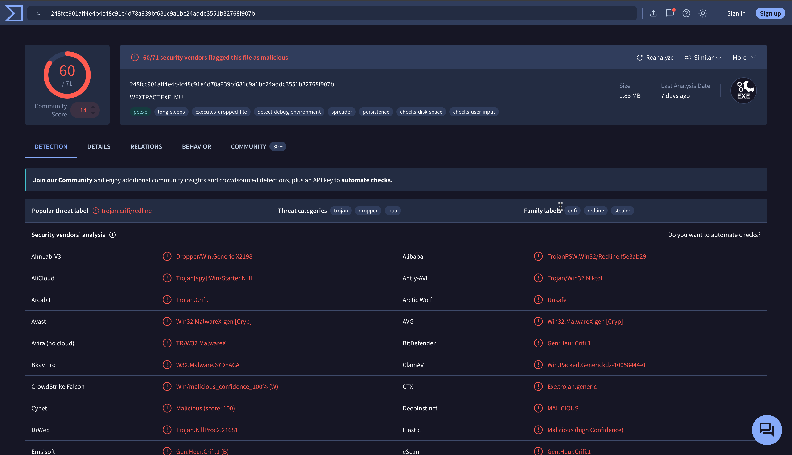
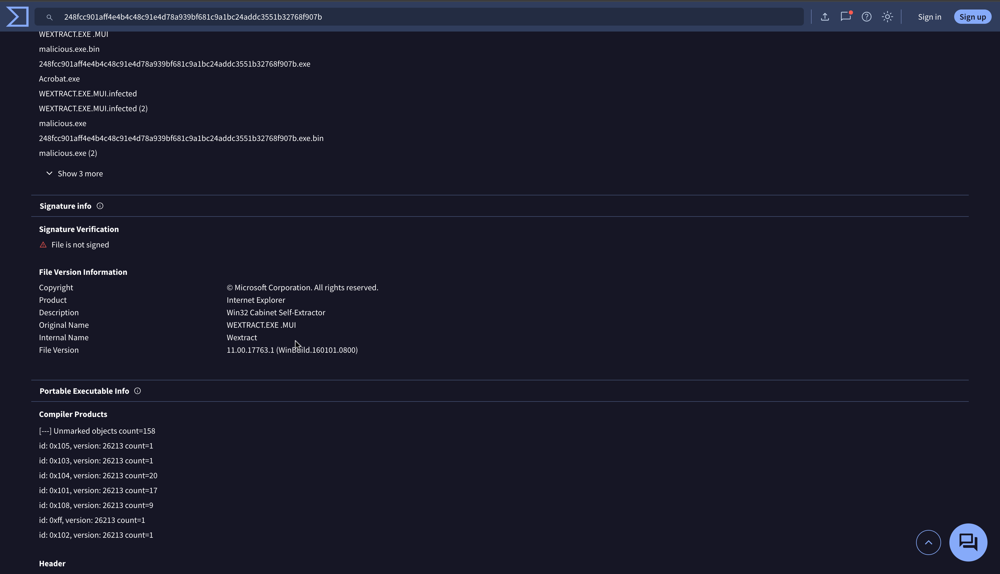
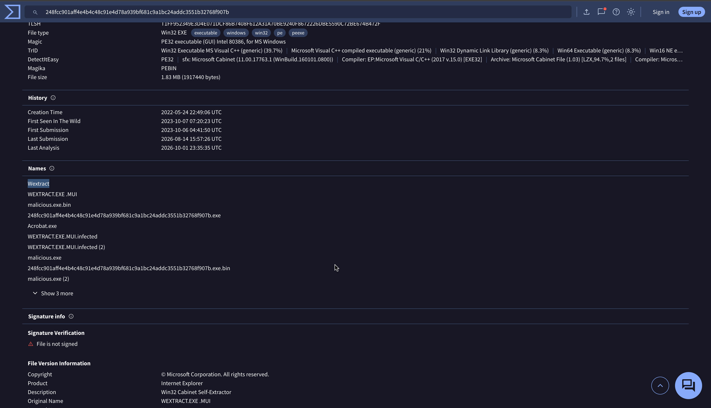
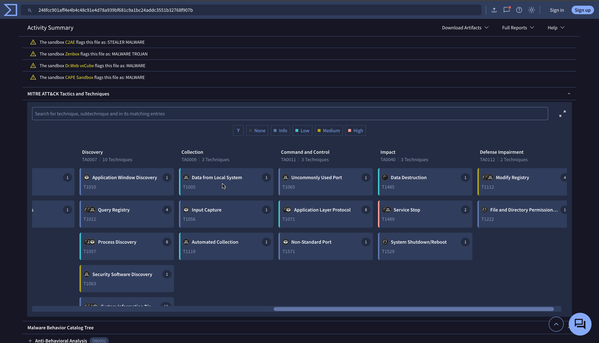
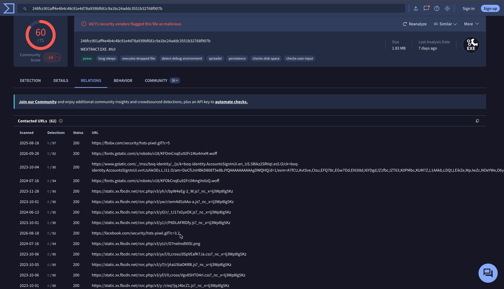
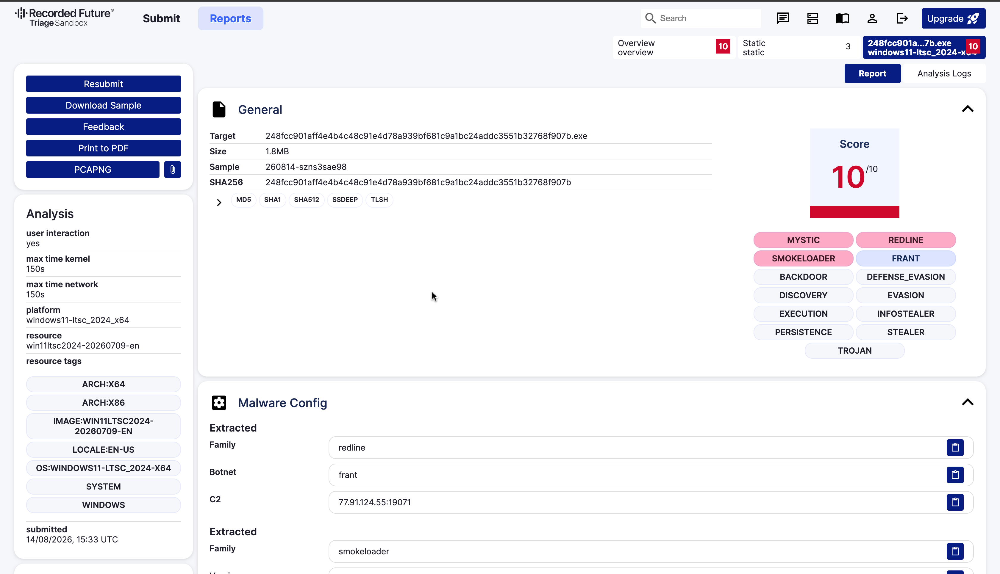
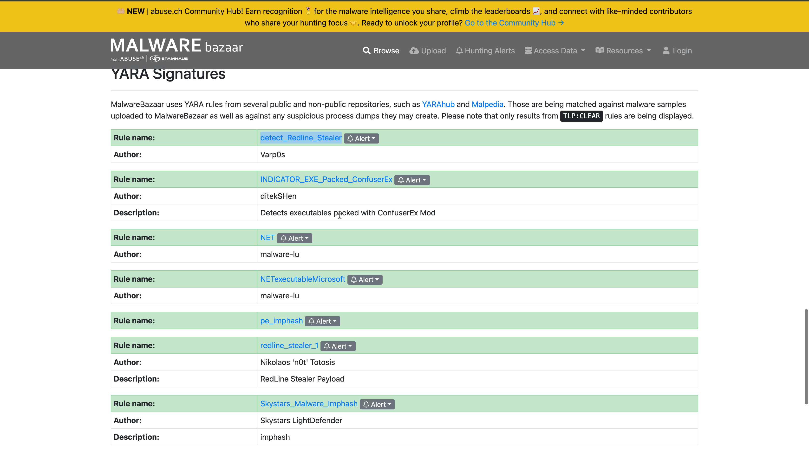
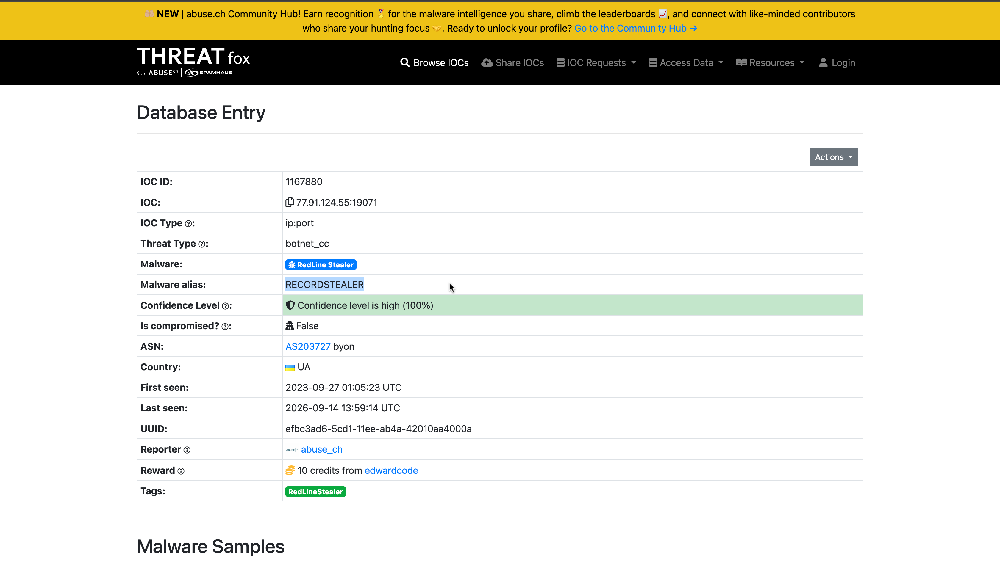
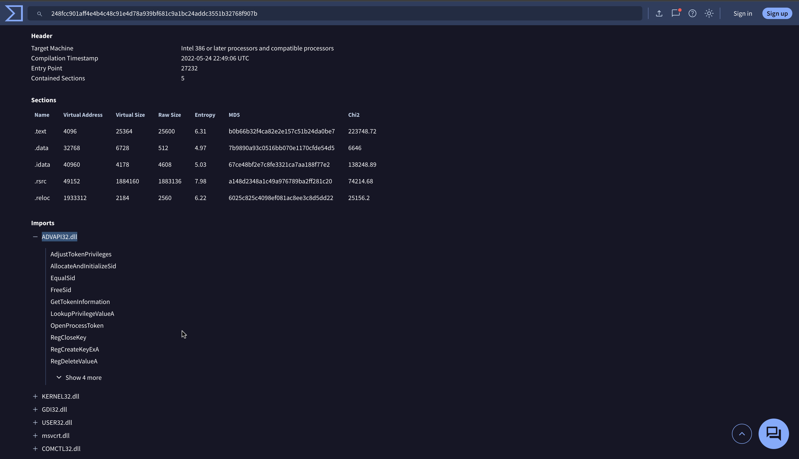

# Red Stealer — RedLine Stealer Triage

| | |
|---|---|
| **Platform** | CyberDefenders |
| **Category** | Threat Intel |
| **Tools** | VirusTotal, MalwareBazaar, Malpedia, ThreatFox, ANY.RUN |
| **ATT&CK** | T1005 (Data from Local System) |

## Overview

A suspicious executable was recovered from a workstation and suspected of C2 communication. The investigation is conducted as a threat-intelligence triage from a single starting indicator, the file hash, with no execution of the sample. The objective is to classify the file, identify its command-and-control infrastructure and malware family, and produce actionable intelligence for the incident-response team by pivoting across public intelligence platforms.

**Starting indicator (SHA-256):** `248FCC901AFF4E4B4C48C91E4D78A939BF681C9A1BC24ADDC3551B32768F907B`

## Methodology

### 1. Classify the sample (VirusTotal)

VirusTotal is queried first because a single hash lookup returns classification, naming, timeline, and behaviour. The detections return a popular threat label of `trojan.crifi/redline` with categories trojan / dropper / pua, classifying the sample as a Trojan and indicating the RedLine family. The Details tab provides the file identity: original name `WEXTRACT.EXE .MUI`, internal name `Wextract`, additional names `malicious.exe` and `red.exe`, and a first submission of `2023-10-06 04:41:50 UTC`.

### 2. Establish behaviour

Classification does not describe runtime behaviour, so the VirusTotal Behavior tab is reviewed. Its MITRE ATT&CK board lists Collection / Data from Local System (T1005), consistent with an information stealer harvesting local data. The Relations tab lists `facebook.com` among contacted domains; this is a decoy, legitimate-domain traffic used to blend in, and not the genuine C2. Because the real C2 resides in the malware configuration rather than DNS, a sandbox is required.

### 3. Extract the C2 configuration (Triage)

Hatching Triage decodes the embedded malware configuration directly, returning family `redline`, botnet `frant`, and C2 `77.91.124.55:19071`. This is the actionable blocking indicator, held in the decoded configuration rather than in DNS traffic.

### 4. Obtain a detection signature and resolve the family

MalwareBazaar is queried on the hash to obtain a deployable detection signature, the YARA rule `detect_Redline_Stealer` by author Varp0s. ThreatFox is queried on the C2 to resolve cross-platform family aliasing, which returns RedLine Stealer with the alias `RECORDSTEALER`. Aliasing matters because VirusTotal, Malpedia, and ThreatFox each name the family differently, and aligning the aliases is necessary to correlate intelligence across sources.

### 5. Confirm capability from PE imports

The VirusTotal Imports tab lists `ADVAPI32.dll` exposing `AdjustTokenPrivileges`, `OpenProcessToken`, and `LookupPrivilegeValueA`. This is the token-manipulation API set used for privilege escalation, which complements the local-data collection behaviour (T1005) with a privilege-escalation capability (access token manipulation, T1134).

## Key findings

| Type | Value | Context |
|---|---|---|
| SHA-256 | `248FCC901AFF4E4B4C48C91E4D78A939BF681C9A1BC24ADDC3551B32768F907B` | sample |
| Category | Trojan | VirusTotal detections |
| File name | `Wextract.EXE` (aliases `malicious.exe`, `red.exe`) | VirusTotal Details / Names |
| First submission | 2023-10-06 04:41:50 UTC | VirusTotal |
| C2 | `77.91.124.55:19071` (bot ID `frant`) | decoded config / sandbox |
| Decoy domain | `facebook.com` | DNS resolution used to blend in |
| YARA rule | `detect_Redline_Stealer` (by Varp0s) | MalwareBazaar |
| Family | RedLine Stealer (alias `RECORDSTEALER`) | Malpedia / ThreatFox |
| PrivEsc DLL | `ADVAPI32.dll` | PE imports (AdjustTokenPrivileges, OpenProcessToken, LookupPrivilegeValueA) |

## MITRE ATT&CK mapping

| Tactic | Technique | ID | Evidence |
|---|---|---|---|
| Collection | Data from Local System | T1005 | `applaunch.exe` harvesting browser data before exfiltration |
| Privilege Escalation | Access Token Manipulation | T1134 | `ADVAPI32.dll`: AdjustTokenPrivileges / OpenProcessToken / LookupPrivilegeValueA |

## Analysis notes and detection

- Threat-intelligence triage is a pivot chain from one indicator: a single hash was expanded into category, naming, C2, family, YARA signature, and capability without executing the sample.
- The `facebook.com` resolution was a decoy. The genuine C2 (`77.91.124.55:19071`) resided in the decoded configuration, not in DNS. Contacted domains should not be assumed to be command-and-control.
- Family aliasing (`RECORDSTEALER`) requires aligning names across platforms to correlate intelligence.
- **Detection:** block `77.91.124.55:19071`; deploy the `detect_Redline_Stealer` YARA rule; alert on processes calling `AdjustTokenPrivileges` via `ADVAPI32.dll` and on access to browser credential stores (T1005).

<!-- Retired lab. IOCs are from the public sample. Screenshots cropped to remove browser chrome / account identifiers. -->
